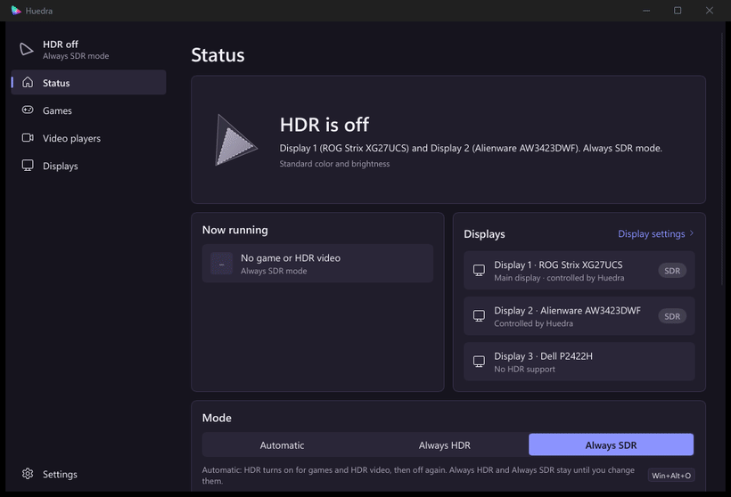
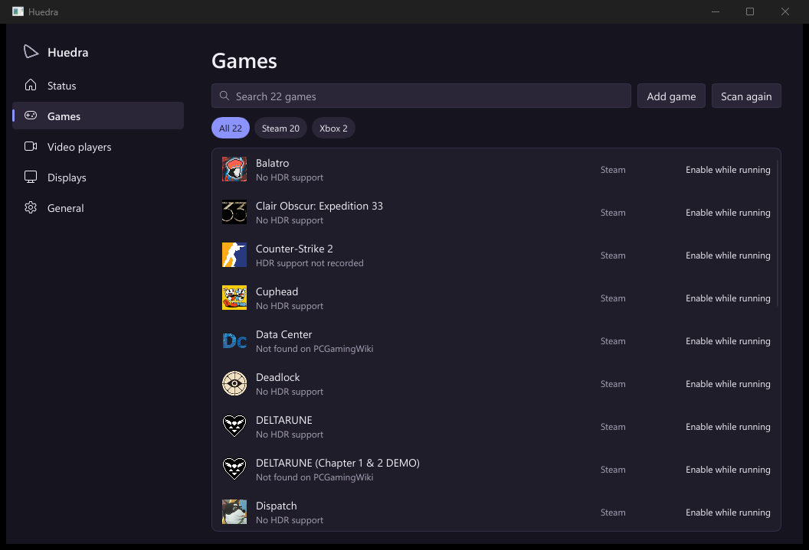

  
  <h1>Huedra</h1>
  
<strong>Automatic HDR for Windows.</strong> HDR turns on when a game or HDR video starts, and off again when it ends.

  

    
    
    
    
    
  

  

    <a href="../../releases"><strong>Download</strong></a> ·
    <a href="docs/USER-GUIDE.md">User guide</a> ·
    <a href="../../issues">Report a problem</a> ·
    <a href="#support-the-project">Support the project</a>
  

> [!NOTE]
> Huedra changes a Windows display setting; please read the [disclaimer](#disclaimer) before using it.

  

## Why Huedra

Windows HDR makes HDR games and video look as intended, but it makes the desktop and SDR content look washed out. Most people switch it by hand before playing and forget to switch it back. Huedra does it for you, per display, and leaves everything else alone.

## Features

| | |
| --- | --- |
| **Games, found automatically** | Reads the libraries of Steam, Epic Games, GOG, Xbox, Ubisoft Connect, EA app, Rockstar Games, Battle.net, Riot Games, HoYoPlay, Amazon Games, itch.io and Heroic Games Launcher, plus the games the Xbox Game Bar recognized. HDR turns on while a game runs, with an optional delay per game and a time to keep HDR on after it closes. |
| **HDR video** | VLC, mpv, MPC-HC, MPC-BE and PotPlayer, by the title of the file playing. YouTube and streaming sites through the Huedra browser extension. RTX Video HDR aware. |
| **The right display** | Only the display showing the game or video switches, and HDR follows the window to another display. Always HDR mode and the shortcut switch only the main display, unless you choose every display. |
| **Start with HDR** | For games that misbehave when HDR changes while they start: a Steam launch option, a desktop shortcut, or a File Explorer menu entry turns HDR on first. |
| **Light on the system** | One small executable, no installer, no background polling: Huedra waits for Windows to report a change. About 2 MB of memory. |
| **Safe by design** | Runs without administrator rights. Never reads or writes another program's memory. Updates install only with a valid signature, and keep your settings. |
| **Private** | No accounts and no telemetry. See [PRIVACY.md](PRIVACY.md). |

  

## Getting started

1. Download `huedra-<version>-windows-x64.zip` from the newest [release](../../releases).
2. Unpack it into a folder of your own, for example `%LOCALAPPDATA%\Programs\Huedra`.
3. Start `huedra.exe` and accept the disclaimer.

Huedra opens its window, runs in the notification area in Automatic mode, adds itself to Windows start-up and finds your games. Nothing else needs to be set up. Closing the window keeps Huedra running; starting `huedra.exe` again brings the window back.

**Requirements:** Windows 10 (version 1903 or later) or Windows 11, 64-bit, and a display that supports HDR.

The [setup guide](docs/SETUP.md) walks through installing, testing, the browser extension and troubleshooting step by step. The [user guide](docs/USER-GUIDE.md) covers every setting, the browser extension, keyboard shortcuts, the command line, troubleshooting and removal.

## Frequently asked questions

**Is it safe to use with anti-cheat software?**
Huedra reads only the name and path of the program in front and waits for programs to close. It never reads or writes another program's memory and never injects code. No game publisher has reviewed it, so this cannot be guaranteed.

**Why does Windows SmartScreen show a warning?**
Huedra does not yet have a Windows code-signing certificate. Choose **More info** and **Run anyway**. Every release is signed with the project's own key, and updates are installed only when that signature is valid.

**Why does the screen go black briefly?**
That is Windows changing the display mode, as it does when HDR is switched in Windows Settings.

**What has it been tested on?**
Windows 11 with an NVIDIA graphics card and two HDR displays. Reports from AMD and Intel graphics, Windows 10 and laptops are very welcome.

## Support the project

If Huedra is useful to you:

- **Star the repository** on GitHub, so that others can find it.
- **Support development** on [Buy Me a Coffee](https://buymeacoffee.com/pixelsthecoder).
- **Report problems and test** on hardware the project has not seen yet.

Both links are also in the app, under **Settings › About**, and Buy Me a Coffee is in the tray menu.

### Supporters

Every feature of Huedra is free for everyone; nothing is locked behind support. As a thank-you, supporters on Buy Me a Coffee:

- are named in [SUPPORTERS.md](SUPPORTERS.md), if they wish, and thanked in every release's notes;
- get preview builds through Buy Me a Coffee about a week before each public release (signed release builds, like every download);
- have their issues marked with the `sponsor` label.

Thank you to everyone in [SUPPORTERS.md](SUPPORTERS.md).

## Contributing

Contributions are welcome. [CONTRIBUTING.md](CONTRIBUTING.md) explains how to build Huedra, the project layout and what a pull request needs. Changes are listed in [CHANGELOG.md](CHANGELOG.md).

## License

Huedra is licensed under the [Apache License, Version 2.0](LICENSE). The settings window uses [Slint](https://slint.dev) under the Slint Royalty-free Desktop, Mobile, and Web Applications License 2.0.

## Disclaimer

- **Software changes.** Huedra may contain bugs, and its behavior and settings may change between releases.
- **No warranty.** Huedra is provided "as is", without warranty of any kind, as set out in sections 7 and 8 of the [license](LICENSE). You use it at your own risk. Its authors and contributors are not liable for any damage, data loss or other problem with your computer, displays, games or other software that may result from using it.
- **Display settings.** Huedra changes only the HDR setting that Windows offers. An interrupted switch can leave a display in HDR or SDR until it is changed back under **Settings › System › Display**, or with `huedra hdr off --display all`.
- **Not affiliated.** Huedra is an independent project, not affiliated with, endorsed by or sponsored by Microsoft, NVIDIA, AMD, Intel, Valve, Epic Games, GOG, Ubisoft, Electronic Arts, Rockstar Games, Blizzard Entertainment, Riot Games, HoYoverse, Amazon, itch.io, the Heroic Games Launcher project, Google, Mozilla, PCGamingWiki, Discord, any streaming service, or the SmartHdrManager project. Product names and trademarks belong to their owners.
- **Game information.** Details about games come from PCGamingWiki and Discord and may be incomplete or inaccurate.
- **AI-assisted development.** Parts of Huedra's source code, documentation and artwork were written with the help of AI tools. Every change is reviewed and tested by the maintainer and must pass the project's automated checks, but, as with any software, mistakes can remain. Please report anything that looks wrong.

## Acknowledgements

- [SmartHdrManager](https://github.com/VantaCode420/SmartHdrManager), for the original idea.
- [PCGamingWiki](https://www.pcgamingwiki.com), for game information (CC BY-NC-SA 3.0).
- [Slint](https://slint.dev), for the user interface toolkit.
- [minisign](https://jedisct1.github.io/minisign/), for release signatures.
