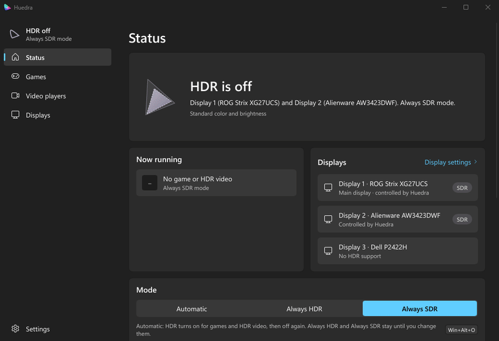
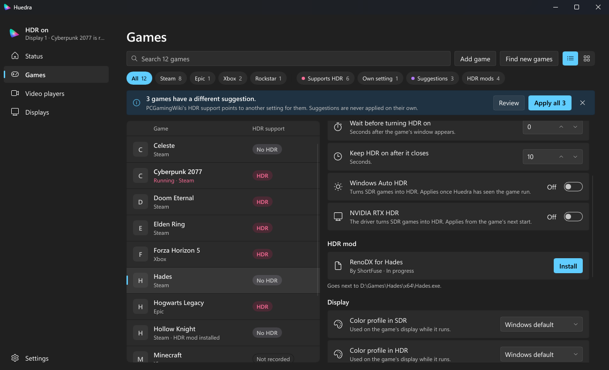

  
  <h1>Huedra</h1>
  
<strong>Automatic HDR for Windows.</strong> HDR turns on when a game or HDR video starts, and off again when it ends.

  

    
    
    
    
    
  

  

    <a href="../../releases"><strong>Download</strong></a> ·
    <a href="docs/USER-GUIDE.md">User guide</a> ·
    <a href="../../issues">Report a problem</a> ·
    <a href="#support-the-project">Support the project</a>
  

> [!NOTE]
> Huedra changes a Windows display setting; please read the [disclaimer](#disclaimer) before using it.

  

## Why Huedra

Windows HDR makes HDR games and video look as intended, but it makes the desktop and SDR content look washed out. Most people switch it by hand before playing and forget to switch it back. Huedra does it for you, per display, and leaves everything else alone.

> [!TIP]
> **New: HDR mods.** For games with poor or no HDR, Huedra can install a [RenoDX](https://github.com/clshortfuse/renodx) or [Luma](https://github.com/Filoppi/Luma-Framework) HDR mod for you, and remove it just as cleanly. Windows Auto HDR and NVIDIA RTX HDR now have simple per-game switches. See [HDR mods](#hdr-mods).

## Features

| | |
| --- | --- |
| **HDR mods** *(new)* | Shows which of your games have a RenoDX or Luma HDR mod and installs it into the game's folder, usually without starting the game first. Mods without a direct download link to their page instead. Every file is recorded, and **Remove** puts the game back exactly as it was. Mods you installed yourself are recognized too. |
| **Auto HDR and RTX HDR** *(new)* | Windows Auto HDR and NVIDIA RTX HDR are off unless you turn them on, for every game in Settings or one game at a time in its details. Both stay off for games with an HDR mod, so they don't work against it. RTX HDR needs an NVIDIA graphics card; everything else works with any graphics card. |
| **Games, found automatically** | Reads the libraries of Steam, Epic Games, GOG, Xbox, Ubisoft Connect, EA app, Rockstar Games, Battle.net, Riot Games, HoYoPlay, Amazon Games, itch.io and Heroic Games Launcher, plus the games the Xbox Game Bar recognized. HDR turns on while a game runs, with an optional delay per game and a time to keep HDR on after it closes. |
| **HDR video** | VLC, mpv, MPC-HC, MPC-BE and PotPlayer, by the title of the file playing. YouTube and streaming sites through the Huedra browser extension. RTX Video HDR aware. |
| **The right display** | Only the display showing the game or video switches, and HDR follows the window to another display. Always HDR mode and the shortcut switch only the main display, unless you choose every display. |
| **Quick panel** | A click on the tray icon shows whether HDR is on and why, the mode, and a switch per display, with Pause and Never use HDR for the game running, without opening the window. |
| **Start with HDR** | For games that misbehave when HDR changes while they start: a Steam launch option, a desktop shortcut, or a File Explorer menu entry turns HDR on first. |
| **Light on the system** | One small executable, no installer, no background polling: Huedra waits for Windows to report a change. About 2 MB of memory. |
| **Safe by design** | Runs without administrator rights. Never reads or writes another program's memory. Updates install only with a valid signature, and keep your settings. |
| **Private** | No accounts and no telemetry. See [PRIVACY.md](PRIVACY.md). |

## HDR mods

Some games have no HDR, or HDR that looks wrong. Community projects fix many of them: [RenoDX](https://github.com/clshortfuse/renodx) mods run on [ReShade](https://reshade.me), and [Luma](https://github.com/Filoppi/Luma-Framework) brings its own. Huedra puts them a click away:

  

- **Find.** Huedra reads the RenoDX and Luma mod lists once a day and marks the games that have a mod: the cover grid shows **Mod available**, and the **HDR mods** filter lists them all.
- **Install.** For mods with a direct download, **Install** shows what will change, then downloads the mod from the link in its project's list (and ReShade from reshade.me, for RenoDX) and puts it next to the game's program. Huedra usually finds the program in the game's folder, so the game doesn't have to run first, and it shows where the mod goes before anything is copied. Mods offered only on a page such as Nexus Mods get a link to that page.
- **Remove.** Huedra records every file it adds or replaces and keeps a backup of anything it replaces. **Remove** deletes only the files it added and restores the backups, and uninstalling Huedra removes its mods too.
- **Recognize.** A RenoDX or Luma mod you installed yourself is recognized, and Auto HDR and RTX HDR stay off for that game as well. **Remove** takes it out too: the dialog lists each file first (the add-on, Luma's folder, and ReShade with its settings unless other add-ons use it), and Huedra keeps a copy of everything it takes out.
- **Stay safe online.** Huedra won't install a mod in a game that PCGamingWiki lists with anti-cheat, warns about games with online play, and asks you to confirm before the first install. Changed game files can get an account banned in online games; the mods are made by their own authors, and you install them at your own risk.

## Getting started

1. Download `huedra-<version>-windows-x64.zip` from the newest [release](../../releases).
2. Unpack it into a folder of your own, for example `%LOCALAPPDATA%\Programs\Huedra`.
3. Start `huedra.exe` and accept the disclaimer.

Huedra opens its window, runs in the tray in Automatic mode, adds itself to Windows start-up and finds your games. Nothing else needs to be set up. Closing the window keeps Huedra running; starting `huedra.exe` again brings the window back.

**Requirements:** Windows 10 (version 1903 or later) or Windows 11, 64-bit, and a display that supports HDR.

The [setup guide](docs/SETUP.md) walks through installing, testing, the browser extension and troubleshooting step by step. The [user guide](docs/USER-GUIDE.md) covers every setting, the browser extension, keyboard shortcuts, the command line, troubleshooting and removal.

## Frequently asked questions

**Is it safe to use with anti-cheat software?**
Huedra reads only the name and path of the program in front and waits for programs to close. It never reads or writes another program's memory and never injects code. No game publisher has reviewed it, so this cannot be guaranteed. HDR mods are different: they change game files, so Huedra won't install one in a game that PCGamingWiki lists with anti-cheat, and warns about games with online play.

**Why does Windows SmartScreen show a warning?**
Huedra does not yet have a Windows code-signing certificate. Choose **More info** and **Run anyway**. Every release is signed with the project's own key, and updates are installed only when that signature is valid.

**Why does the screen go black briefly?**
That is Windows changing the display mode, as it does when HDR is switched in Windows Settings.

**What has it been tested on?**
Windows 11 with an NVIDIA graphics card and two HDR displays. Reports from AMD and Intel graphics, Windows 10 and laptops are very welcome.

## Support the project

If Huedra is useful to you:

- **Star the repository** on GitHub, so that others can find it.
- **Support development** on [Buy Me a Coffee](https://buymeacoffee.com/pixelsthecoder).
- **Report problems and test** on hardware the project has not seen yet.

Both links are also in the app, under **Settings › About**, and Buy Me a Coffee is in the tray menu.

### Supporters

Every feature of Huedra is free for everyone; nothing is locked behind support. As a thank-you, supporters on Buy Me a Coffee:

- are named in [SUPPORTERS.md](SUPPORTERS.md), if they wish, and thanked in every release's notes;
- get preview builds through Buy Me a Coffee about a week before each public release (signed release builds, like every download);
- have their issues marked with the `sponsor` label.

Thank you to everyone in [SUPPORTERS.md](SUPPORTERS.md).

## Contributing

Contributions are welcome. [CONTRIBUTING.md](CONTRIBUTING.md) explains how to build Huedra, the project layout and what a pull request needs. Changes are listed in [CHANGELOG.md](CHANGELOG.md).

## Code signing policy

Free code signing provided by [SignPath.io](https://about.signpath.io/), certificate by [SignPath Foundation](https://signpath.org/).

The project has applied to the SignPath Foundation, and releases are not Windows-signed until the application is approved. Every release is already signed with the project's own key (minisign), and Huedra installs updates only when that signature is valid.

- **What is signed:** only `huedra.exe`, built from this repository by the [Release workflow](.github/workflows/release.yml) on GitHub Actions, from a version tag on `main`. Nothing built elsewhere and no third-party program is signed.
- **Committers and reviewers:** the maintainers of the [apixelsnet](https://github.com/apixelsnet) organization on GitHub. Changes reach `main` only through pull requests that pass the project's checks.
- **Approvers:** the same maintainers. Each release is started by hand, and each signing request is approved by a maintainer.
- **Accounts:** the maintainers' GitHub and SignPath accounts must use multi-factor authentication.

**Privacy.** Huedra connects to other systems only for these features, both on by default and both can be turned off under **Settings**:

- **Updates:** once a day it downloads the release files from this repository's GitHub releases (`github.com`).
- **Game information and icons:** the settings window looks up installed games on PCGamingWiki (`www.pcgamingwiki.com`) and downloads Discord's public game list and game icons (`discord.com`, `cdn.discordapp.com`).

Nothing else is sent anywhere. See [PRIVACY.md](PRIVACY.md) for details.

## License

Huedra is licensed under the [Apache License, Version 2.0](LICENSE). The settings window uses [Slint](https://slint.dev) under the Slint Royalty-free Desktop, Mobile, and Web Applications License 2.0.

## Disclaimer

- **Software changes.** Huedra may contain bugs, and its behavior and settings may change between releases.
- **No warranty.** Huedra is provided "as is", without warranty of any kind, as set out in sections 7 and 8 of the [license](LICENSE). You use it at your own risk. Its authors and contributors are not liable for any damage, data loss or other problem with your computer, displays, games or other software that may result from using it.
- **Display settings.** Huedra changes only the HDR setting that Windows offers. An interrupted switch can leave a display in HDR or SDR until it is changed back under **Settings › System › Display**, or with `huedra hdr off --display all`.
- **Not affiliated.** Huedra is an independent project, not affiliated with, endorsed by or sponsored by Microsoft, NVIDIA, AMD, Intel, Valve, Epic Games, GOG, Ubisoft, Electronic Arts, Rockstar Games, Blizzard Entertainment, Riot Games, HoYoverse, Amazon, itch.io, the Heroic Games Launcher project, the ReShade, RenoDX or Luma projects, Google, Mozilla, PCGamingWiki, Discord, any streaming service, or the SmartHdrManager project. Product names and trademarks belong to their owners.
- **Game information.** Details about games come from PCGamingWiki and Discord and may be incomplete or inaccurate.
- **HDR mods.** RenoDX, Luma and ReShade are made by their own authors, not by Huedra. Huedra downloads them for you when you ask; it does not check or support what they do in a game. Installing a mod changes game files, which some games and online services forbid. You are responsible for that choice, and Huedra's authors are not liable for bans, game problems or lost progress.
- **AI-assisted development.** Parts of Huedra's source code, documentation and artwork were written with the help of AI tools. Every change is reviewed and tested by the maintainer and must pass the project's automated checks, but, as with any software, mistakes can remain. Please report anything that looks wrong.

## Acknowledgements

- [SmartHdrManager](https://github.com/VantaCode420/SmartHdrManager), for the original idea.
- [PCGamingWiki](https://www.pcgamingwiki.com), for game information (CC BY-NC-SA 3.0).
- [RenoDX](https://github.com/clshortfuse/renodx), [Luma](https://github.com/Filoppi/Luma-Framework) and [ReShade](https://reshade.me), and the authors of their mods, for HDR mods. Huedra downloads them from the links in their lists and does not include them.
- [Slint](https://slint.dev), for the user interface toolkit.
- [minisign](https://jedisct1.github.io/minisign/), for release signatures.
